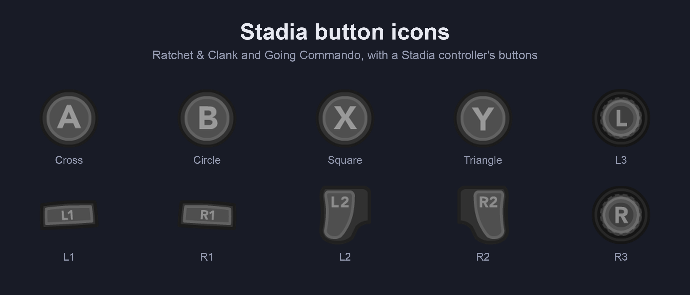
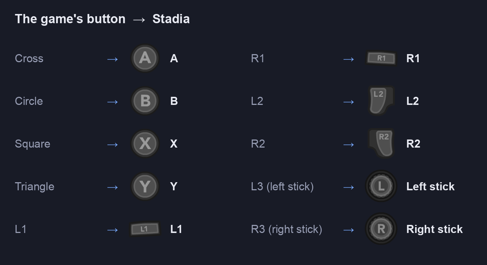

# Stadia button icons

The game's PlayStation 2 button icons as a Stadia controller's, for Ratchet & Clank and Going
Commando.

## What it does

Everywhere the game prints a button (help messages, menus, the save screens, the vendor), you see
a Stadia controller's button instead, drawn from the real Stadia button art: flat greys, the dark
rim, the letter in a lighter grey. With the mod off, the game is the PlayStation 2 game.

| The game's | Becomes |
|---|---|
| Cross | **A** (bottom) |
| Circle | **B** (right) |
| Square | **X** (left) |
| Triangle | **Y** (top) |
| L1, R1 | Stadia's **L1**, **R1** |
| L2, R2 | Stadia's **L2**, **R2** triggers |
| L3, R3 | Stadia's left and right sticks, **L** and **R** |

The buttons are sharp at any resolution: the port draws them from larger pictures.

## How to use it

Install it from the launcher's **Mods** tab (**Add from a link**:
`https://github.com/Promises/rac-stadia-icons`), switch it on and play. It only changes pictures:
which button does what stays the game's.

## Settings

| Setting | Default | Choices | What it does |
|---|---|---|---|
| Trace | Off | On, Off | For bug reports: writes a line in the game's log each time the button icons are painted, or found not to be the game's. |

## Requirements

- **OpenRAC with mod interface 1.36.** The launcher offers the mod only to an OpenRAC that has it.
- **Ratchet & Clank:** PAL and NTSC-U.
- **Going Commando:** NTSC-U, PAL and NTSC-U v2.00.
- **Works with [button-swap](https://github.com/OpenRAC/openrac-mods/tree/master/button-swap):** the
  prompts show the buttons the game asks for.

## Compatibility and known issues

- **Conflicts with xbox-icons:** both paint the game's button icons, so only one can be on.
- Words stay as they are: a message that spells out START or SELECT in letters still does.

## Credits

By Henning Berge and Lynder063. A fork of
[xbox-icons](https://github.com/OpenRAC/openrac-mods/tree/master/xbox-icons) by Lynder063. The Stadia
button pictures are from Xelu's FREE Controllers & Keyboard PROMPTS by Nicolae (XELU) Berbece (CC0).
Stadia and its logo are trademarks of Google LLC, used only to say which controller the icons are
for; this mod is not made or endorsed by Google.

Licence: GPL-3.0-or-later (details in the [README](README.md#credits-and-licence)).

## Feedback

Found a bug or have an idea? Open an issue on
[GitHub](https://github.com/Promises/rac-stadia-icons/issues). Pull requests are welcome.

Developer documentation: [README](README.md)
