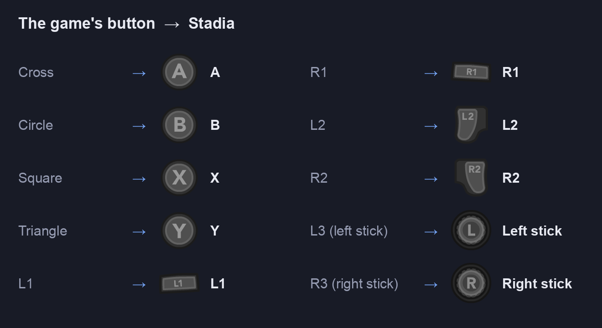

# Stadia button icons

Ratchet & Clank's and Going Commando's PlayStation 2 button icons as a Stadia controller's, for
OpenRAC's native port (Ratchet & Clank: PAL and NTSC-U; Going Commando: NTSC-U, PAL and NTSC-U
v2.00), drawn from the real Stadia button art. Everywhere the game prints a button: help messages,
menus, the save screens, the vendor.

With the mod off, the game is the PlayStation 2 game.



| The game's | Becomes |
|---|---|
| Cross | **A** (the bottom button, as on a Stadia controller) |
| Circle | **B** (right) |
| Square | **X** (left) |
| Triangle | **Y** (top) |
| L1, R1 | Stadia's **L1**, **R1** |
| L2, R2 | Stadia's **L2**, **R2** triggers |
| L3, R3 | Stadia's left and right sticks, **L** and **R** |

The buttons are Stadia's own: flat greys, the dark rim, the letter in a lighter grey.

It is a fork of [xbox-icons](https://github.com/OpenRAC/openrac-mods/tree/master/xbox-icons) by
Lynder063: the finding of the fonts, the discs' tables, the fonts' hashes and the palette rule are
theirs; the pictures and their painting are new.

## Playing

Install it from the launcher's **Mods** tab (**Add from a link**:
`https://github.com/Promises/rac-stadia-icons`), switch it on and play. It only changes pictures:
which button does what is the game's (or [button-swap](https://github.com/OpenRAC/openrac-mods/tree/master/button-swap)'s,
which it works with: the prompts show the buttons the game asks for). It cannot be on together with
xbox-icons: both paint the same cells.

| Setting | Default | |
|---|---|---|
| Trace | off | For bug reports: a line in the game's log each time the fonts are painted, or found not to be the game's |

The game's words stay as they are: a message that says START or SELECT in letters still does.

## Sharp buttons

The game's button cells are 24 x 16 texels, so at the game's resolution a Stadia button is about
16 texels across: the face buttons' letters read, the shoulders' and the sticks' own labels do not,
so in those cells the label (L1, R2, L...) is written again in letters of 3 x 5 texels on the
button's grey.

The mod needs OpenRAC with mod interface 1.36 ([OpenRAC #803](https://github.com/OpenRAC/OpenRAC/pull/803)),
whose ports draw sharp cells (`openrac_api.sharp_cells`): before it paints the fonts the mod hands
the port each cell drawn 6 times as large (144 x 96, the picture itself, labels as Stadia drew
them), and the port draws those where the cells are shown. The launcher offers the mod only to a
port of 1.36 or later; the mod still checks the port's interface and table before the call, and
on a port without sharp cells it would paint the game-resolution buttons alone.

## How it works

The game prints a button as a glyph of its three fonts (bytes 0x10 to 0x19 of a text): 24 x 16
cells of the fonts' row 96, each font an effect texture of 8-bit texels with one palette of 256
colours for the three. A level keeps its effect bank in game memory, and the game sends the fonts
to the GS from there every frame. After each game tick the mod finds the fonts through the effect
texture table (`src/rac1/rac1.c`, `src/rac2/rac2.c`); when their cells and palette are the game's
own (a hash, one per set of fonts the game has, xbox-icons' own), it paints the ten cells
(`src/common/paint.h`), and the next frame draws the Stadia buttons. Painted fonts are no longer
the game's, so they are painted once a level; fonts the mod does not know, or a bank still loading,
are left alone. It patches no code and takes no hook point. Going Commando's title (its main menu,
Options and the memory card's questions) loads only the first two fonts, with a palette of its own:
those two are painted the same way.

The cells, in row 96: Cross at u 0, Square 24, Triangle 48, Circle 72, L1 96, L2 120, R1 144, R2
168, L3 208, R3 232 (u 192 to 207 holds letters, which stay). Each picture is fitted, its shape
kept, where the game's own button lies in its cell: the face buttons' 16 x 16 sphere, the
shoulders' tab, the sticks' ball.

`tools/stadia_art.py` turns the pictures (`art/stadia/`) into `src/common/stadia_art.h`: each cell
at 6 times its size, and the same averaged down to 24 x 16 with every texel one of 20 greys with a
coverage (for the edges), or clear. The mod puts those greys in palette entries no texel outside
the cells uses (in the game's fonts, all but some fifteen of the 256: the PlayStation symbols'
own among them), the commonest first; an entry a texel outside the cells uses is never changed,
though a colour one already holds is used as it is. With fewer free entries than greys, the
commonest greys get theirs and the others share the nearest colour there is; with fewer than four
colours of its own (clear and three greys), the mod leaves the fonts as they are and says so.

The [tests](tests/) paint fonts made in the test (nothing outside the cells changes, each cell is
the picture's in its own greys, fewer greys when the palette is short, nothing at all when it is
too short), check the sharp cells against ports with and without them (called only on a port that
has them, a page a font, each cell's colours those of the painted texels), and load the library as
the port does, in each game at each disc's addresses. With `OPENRAC_RAC1_LEVEL` or `OPENRAC_RAC2_LEVEL`
naming a level that `openrac-extractor --decompile` wrote (`core_index.bin` and
`unpacked/core_data.bin`), they paint the game's own fonts too, with and without sharp cells (the
cells handed over while the fonts are still the game's).

To see the buttons without the game, `stadia_icons_preview` paints the test's fonts, or a
decompiled level's, and writes the cells as they were, as painted and sharp, as a PNG:

```sh
build/stadia_icons_preview icons.png [decompiler_out/rac1/levels/01]
```

## Building

```sh
python3 tools/fetch_sdk.py          # the SDK sdk.lock pins (1.36.0), into .sdk/
cmake -S . -B build -G Ninja
cmake --build build && ctest --test-dir build
python3 .sdk/openrac-mod-sdk-1.36.0/tools/package_mod.py build/package/stadia_icons -o dist
```

`sdk.lock` pins the released SDK 1.36.0 (`url` and `sha256`), the first with sharp cells.

`python3 tools/stadia_art.py > src/common/stadia_art.h` writes the pictures' tables again (Pillow).
The workflow builds and tests every platform on each push; a tag `v<version>` publishes the release
the launcher installs.

## Credits and licence

- The mod's code: GPL-3.0-or-later ([LICENSE](LICENSE)); from xbox-icons, copyright the OpenRAC
  contributors (Lynder063), and Henning Berge.
- The Stadia pictures: Xelu's FREE Controllers & Keyboard PROMPTS by Nicolae (XELU) Berbece, CC0
  ([art/CREDITS.md](art/CREDITS.md)).

The hub icon shows the Stadia logo, as on the controller's Stadia button. Stadia and its logo
are trademarks of Google LLC; they are used only to say which controller the icons are for. This
mod is not made or endorsed by Google.
